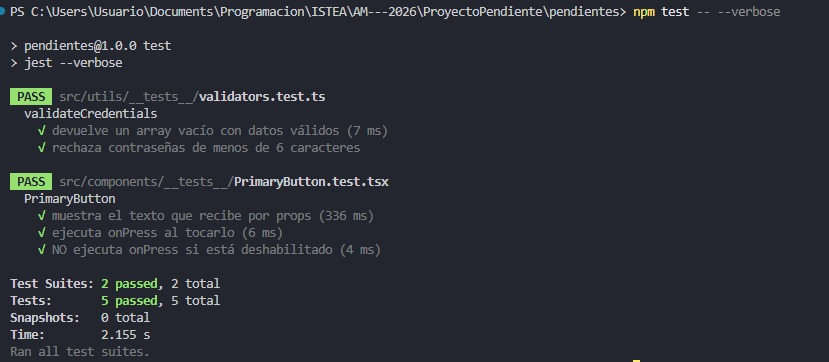

## Presentacion

**1er Parcial - Gestor de tareas "Pendientes"** 

Marteria: Aplicaciones Móviles 
Profesor: Martin Cornejo

Alumno: Joaquin Demarchi
Institucion: ISTEA
Año: 2026

## Qué hace la app

Gestor de tareas con usuarios. Cada tarea tiene título, recordatorio (notificación local),
foto, lugar, responsable y puede agendarse en el calendario del teléfono.

## Tecnologías
 
- React Native + Expo SDK 57 (TypeScript)
- React Navigation — Native Stack
- AsyncStorage (usuarios y tareas)
- expo-notifications (notificaciones locales)
- Jest + jest-expo + React Native Testing Library

## Funcionalidades implementadas
 
- Registro de usuario (usuario + contraseña) guardado en AsyncStorage.
- Login que valida contra los usuarios guardados. Sin sesión no se puede entrar a la app.
- Botón **Salir** para cerrar sesión (al cerrar la app hay que volver a loguearse).
- Alta de tareas con título y recordatorio opcional (10 s, 1 min, 5 min o 1 h).
- Lista de tareas del usuario.
- Marcar tarea como hecha (cancela el aviso pendiente).
- Edición de tareas (título y recordatorio).
- Eliminación de tareas con confirmación (cancela el aviso pendiente).
- Las tareas se guardan por usuario y persisten al cerrar la app.
- 4 tests con Jest + React Native Testing Library: 2 de un componente reutilizable (PrimaryButton) y 2 de lógica de negocio (validación de credenciales).

## Nuevas funcionalidades (Parcial 2)

- **Permisos:** se piden al usar cada recurso. Se manejan los estados concedido, denegado
  y pendiente; si se rechaza, se muestra un mensaje claro y, si quedó bloqueado, un acceso a Ajustes.
- **Cámara y galería:** foto de la tarea con `expo-camera` o elegida con `expo-image-picker`.
  Se ve en la lista (miniatura) y en el formulario.
- **Ubicación:** `expo-location` guarda coordenadas y dirección aproximada del lugar de la tarea,
  con un botón para abrirla en Google Maps.
- **Contactos:** `expo-contacts` permite elegir un responsable de la agenda, con buscador.
- **Calendario:** `expo-calendar` crea un evento vinculado a la tarea (a la hora del aviso
  o dentro de 1 hora, 30 minutos de duración).
- **Estado global:** migrado a **Zustand**. `authStore` (usuario logueado), `tasksStore`
  (lista de tareas con alta, edición, baja y marcar hecha) y `borradorStore` (foto, lugar y
  contacto compartidos entre el formulario, la cámara y la lista de contactos).
- **Testing:** Jest + React Native Testing Library, 5 tests.

## Cómo ejecutar la app

Requisitos: Node.js 20 o superior y **Expo Go para el SDK 57** en el teléfono
(si Play Store tiene el SDK 58, descargar el de la 57 desde https://expo.dev/go).

    git clone https://github.com/joaquinDemarchi/pendientes.git
    cd pendientes
    npm install
    npx expo start

Escanear el QR con Expo Go. Si la red no deja conectar: `npx expo start --tunnel`.

## Tests

## Video demo

[Ver demo en YouTube](https://youtube.com/shorts/23rRFzDq6f0?si=-UCW5qjKGukgTETP)
